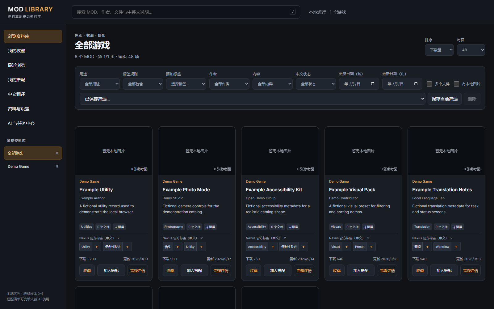
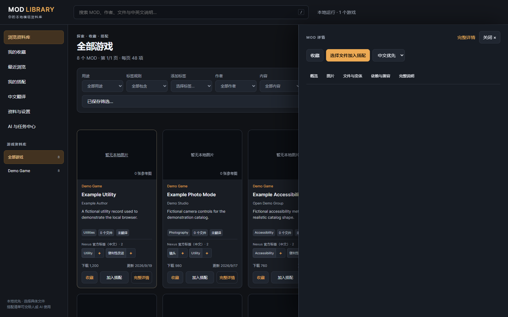
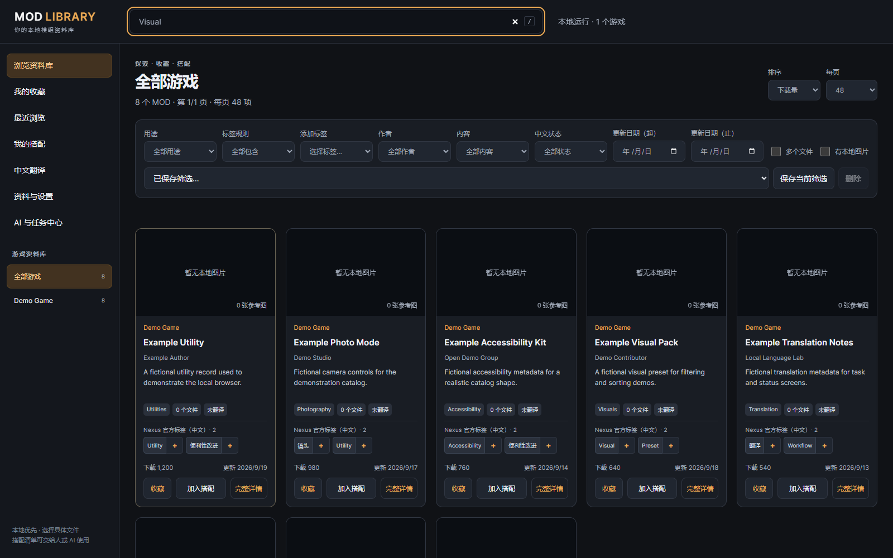
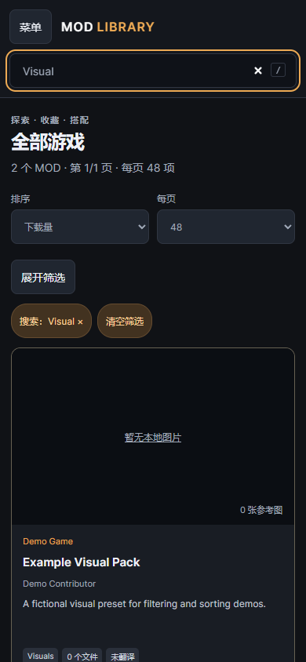
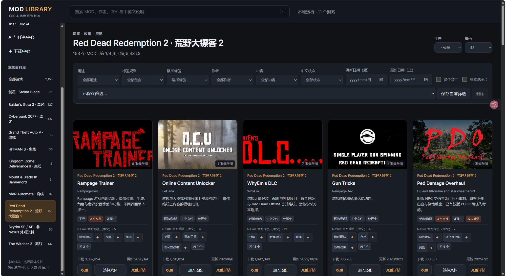
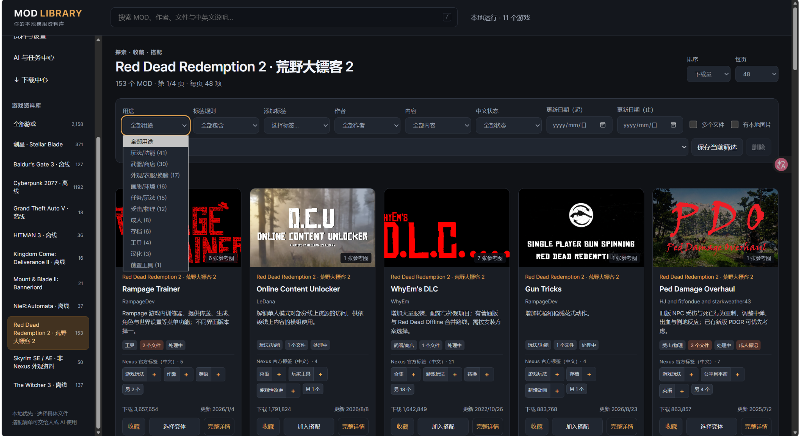
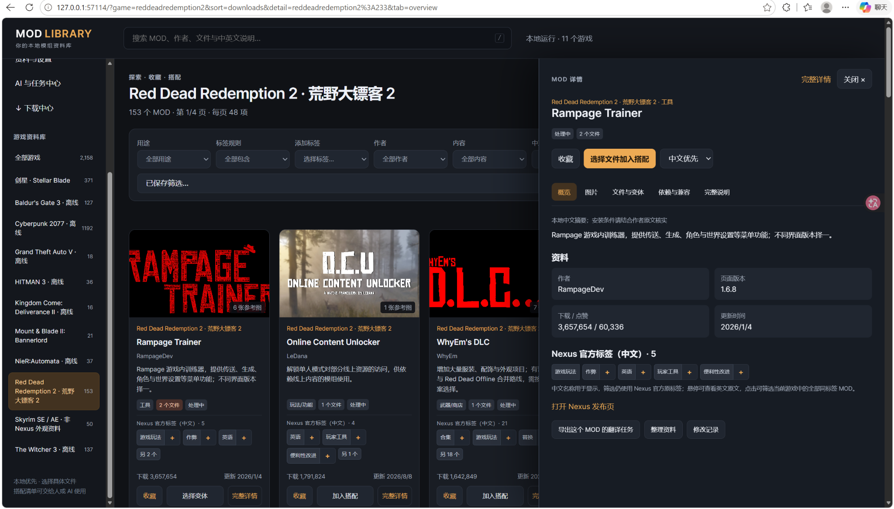
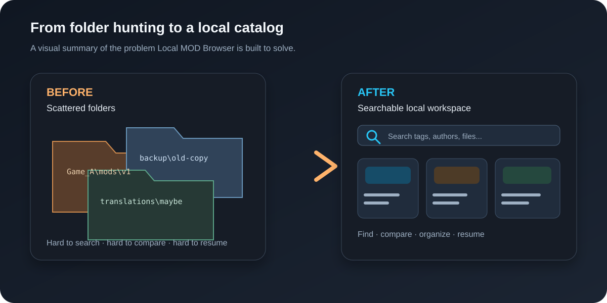

# Local MOD Browser

[简体中文](README.md) · [English](README.en.md) · [日本語](docs/i18n/README.ja.md) · [한국어](docs/i18n/README.ko.md) · [Español](docs/i18n/README.es.md) · [Français](docs/i18n/README.fr.md) · [Deutsch](docs/i18n/README.de.md) · [Português (Brasil)](docs/i18n/README.pt-BR.md) · [Русский](docs/i18n/README.ru.md) · [繁體中文](docs/i18n/README.zh-TW.md)

*These language options translate the README, not the application interface or every guide. Other translations may lag behind.*

<p align="center"></p>


[](https://github.com/son-gladyso/Local-Mod-Browser/actions/workflows/ci.yml)

> **"I swear I downloaded a weather overhaul… for which game? On D: or the old drive? Was it 1.2 or 1.3?"**
>
> Your MOD library should be more than a growing pile of folders. Local MOD Browser turns it into a **local, searchable, recoverable workspace that can work with AI**, so "I remember having that" becomes "found it, checked it, carrying on" in seconds.

[Get started](#five-minute-quick-start) · [Download v2.5.2](https://github.com/son-gladyso/Local-Mod-Browser/releases/tag/v2.5.2) · [For AI agents](#-for-ai-agents) · [Privacy](#privacy-and-security) · [Open an issue](https://github.com/son-gladyso/Local-Mod-Browser/issues)

> **Version status (2026-10-20):** the public release is `v2.5.2` (API contract `2.5.0`). The next version is in separate acceptance and is unreleased. Everything below describes the public release; features in the development candidate or in users' screenshots are not part of it.

---

## 👋 For humans

### Sound familiar?

- MODs spread across drives, games and backup folders, so finding one file takes forever.
- You no longer remember what a MOD does, or why you grabbed it.
- Several versions or copies, and you're afraid to overwrite the original.
- Favorites, translation progress, author info and file lists live in different places and vanish after a reinstall.
- You'd like AI help without uploading your paths and inventory to a third party.
- A batch edit or translation stopped halfway and left half-written records.

### What you get

```text
Your catalog metadata → index & search → details / tags / file comparison → favorites & loadouts
                                               ↓
                              edits / translation jobs / recoverable batches
                                               ↓
                        Web UI, CLI and MCP share one local API
```

| You want… | It gives you |
| --- | --- |
| One search box across games and drives | Multiple local sources, one index; filter by game, keyword, tag combos, translation state, author, date, file info |
| To remember what a MOD is for | Existing summaries, function text and tags; write future plans into loadout notes (**it never guesses why you downloaded something**) |
| One exact file from a MOD | File-level comparison and precise selection |
| Edits without fear | `preview` before `apply`, field allow-lists, version history, rollback |
| Long translations that survive interruptions | Segmented jobs, quality gates, pause/resume, idempotent receipts |
| AI help that keeps data at home | Local HTTP/CLI/MCP on one contract, bound to `127.0.0.1` |
| Recovery after a crash or upgrade | SQLite WAL + FULL sync, paired backups, recovery journal, stable resource IDs |

### See it first

These screenshots use the repository's **8 fully fictional demo records** and show the real public-release UI, not mockups:









Walkthrough: [`docs/demo-walkthrough.md`](docs/demo-walkthrough.md).

#### Real-use screenshots from a user's own library

These are **not shipped** with the project and reflect only that user's environment at the time.







More: [files and variants](docs/assets/real-use/files-and-variants.png) · [AI and task center](docs/assets/real-use/ai-task-center.png) · [download center](docs/assets/real-use/download-center.png), described in the [real-use gallery](docs/real-use-gallery.md). The task-center and download-center images show visible UI state only; **they don't prove success or that those features are in the public release.** Game/MOD names and thumbnails may carry third-party rights not covered by MIT.



### What it is not

**Not** a MOD download site, installer, crack tool or hosted service. It **never downloads, redistributes, installs or executes** MODs, and it doesn't judge whether a MOD is safe, compatible or licensed.

### Five-minute quick start

**Supported:** Windows 10/11 x64; pinned CPython 3.13.15 x64 + SQLite 3.53.4, downloaded and verified on first install (see [`runtime-lock.json`](runtime-lock.json)). Linux/macOS are not supported yet.

```powershell
git clone https://github.com/son-gladyso/Local-Mod-Browser.git
cd Local-Mod-Browser
New-Item -ItemType Directory -Force data | Out-Null
Copy-Item config\sources.example.json data\sources.json
python tools\bootstrap_runtime.py
.\.runtime\python.exe -X utf8 launcher.py --no-browser
```

Or double-click `启动MOD浏览器.cmd`. Open the printed local address to see the fictional demo catalog; **no real MOD library needed.** Source-only? Grab `Local-Mod-Browser-2.5.2-source.zip` from the [v2.5.2 release](https://github.com/son-gladyso/Local-Mod-Browser/releases/tag/v2.5.2) and verify it with `SHA256SUMS.txt`.

**First win:** search a demo entry → open details → back to the list → run `ai.py doctor`.

**Add your own catalog** in the git-ignored `data\sources.json`:

```json
[
  {
    "key": "mygame",
    "title": "My Game",
    "root": "D:\\Mods\\My Game",
    "outputDir": "D:\\Mods\\My Game\\catalog"
  }
]
```

Each `outputDir` holds a `catalog-data.json`. Relative paths resolve from the folder containing `sources.json`; `LOCAL_MOD_BROWSER_SOURCES` can point elsewhere. See [`config/sources.example.json`](config/sources.example.json) and [`examples/demo-game/catalog-data.json`](examples/demo-game/catalog-data.json).

### FAQ

**Why don't I have the huge library from the screenshots?** That's a user's own library; the repo ships 8 fictional records.
**Does it scan and understand every MOD on my disk?** No. It reads source configs plus each `outputDir/catalog-data.json`.
**Empty list?** Check `data\sources.json`, how relative paths resolve, and whether `catalog-data.json` exists. See the [user guide](docs/user-guide.md). Don't paste private databases into issues.
**Do I need AI?** No. The web UI and CLI work directly; MCP is a local interface, not a cloud switch.
**Can I reach it from my LAN or the internet?** It's bound to `127.0.0.1` by default and isn't designed for that.

### Privacy and security

- Indexes only metadata you provide; the repo ships no user library, database, backups or exports.
- Local-only binding (`127.0.0.1`). The service itself never calls a general model, though an external AI client you connect may send what it reads to its provider.
- Errors return a request ID to clients; diagnostics stay local.
- You are responsible for third-party data licensing.
- `.gitignore` covers default runtime/database/token/log paths, but check your staging area before committing.

[Security policy](SECURITY.md) · [Contributing](CONTRIBUTING.md) · [Third-party notices](THIRD_PARTY_NOTICES.md)

### Contribute

See [`ROADMAP.md`](ROADMAP.md). Good first issues: [first-run FAQ (#3)](https://github.com/son-gladyso/Local-Mod-Browser/issues/3) · [source-config docs and validation (#2)](https://github.com/son-gladyso/Local-Mod-Browser/issues/2) · [accessible empty/error states (#1)](https://github.com/son-gladyso/Local-Mod-Browser/issues/1). You don't need your own MOD library. Merging to `main` requires CI, Code Owner approval, resolved discussions, privacy checks and targeted tests. If it solved a real problem for you, a star or a concrete piece of feedback helps.

### License

Project code is [MIT](LICENSE). MIT grants no rights to any MOD, game asset, site data, author text or other third-party content.

---

## 🤖 For AI agents

**Never simulate clicks on the web UI.** Use CLI/HTTP/MCP, which all share the contract in `contracts.py` (70 stable operations, 5 deterministic workflows).

```powershell
.\.runtime\python.exe -X utf8 ai.py tour
.\.runtime\python.exe -X utf8 ai.py capabilities
.\.runtime\python.exe -X utf8 ai.py games
.\.runtime\python.exe -X utf8 ai.py doctor
```

While the server runs, `/api/docs` is the machine-readable contract and `/api/health` reports runtime/DB/service state. Guides: [`docs/ai-platform-guide.md`](docs/ai-platform-guide.md) · [`docs/user-guide.md`](docs/user-guide.md) · [`docs/architecture.md`](docs/architecture.md)

**Workflow: find → verify → change → re-read → report**

1. Read capabilities first.
2. Search and read resources before `preview`; **identify files by resource ID, never by array position.**
3. Check the IDs, versions and diff in the preview, then `apply` with a stable `idempotencyKey`.
4. Wait for a real terminal state and verify with read-back plus the authoritative receipt; **`queued` is not done.**
5. After an interruption, check receipts and the event cursor before continuing, handing off or retrying.

**Boundaries:** don't add or describe download/install/execute/redistribute capabilities; don't bind beyond loopback or add general-model calls server-side; keep HTTP/CLI/MCP consistent; persistence and job changes must cover interruption, retry and recovery; use synthetic data only; there is no per-MOD "download reason" field, so don't invent one.

```text
server.py          local HTTP server + unified error boundary
platform_api.py    70 platform operations and business rules
contracts.py       shared HTTP/CLI/MCP contract and schemas
catalog.py         source config, indexing, query projection
ai.py / mcp_adapter.py   CLI / optional local MCP entry
static/            browser UI
tests/             regression, contract, startup, collaboration, performance
tools/bootstrap_runtime.py   pinned runtime install and verification
```

**Verify:**

```powershell
.\.runtime\python.exe -X utf8 -m unittest discover -s tests -v
.\.runtime\python.exe -X utf8 tests\startup_acceptance.py
.\.runtime\python.exe -X utf8 tests\collaboration_acceptance.py
python -m pip install jsonschema==4.26.0
python -X utf8 tests\contract_audit.py --fixture
node --check static/app.js; node --check static/editor.js; node --check tests/browser.cjs
```
