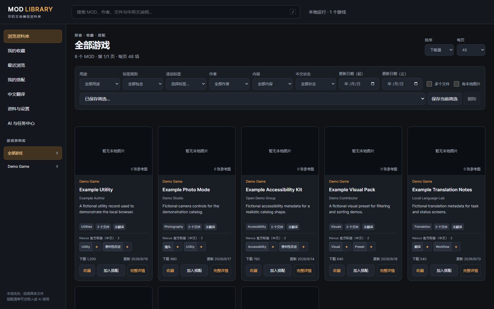
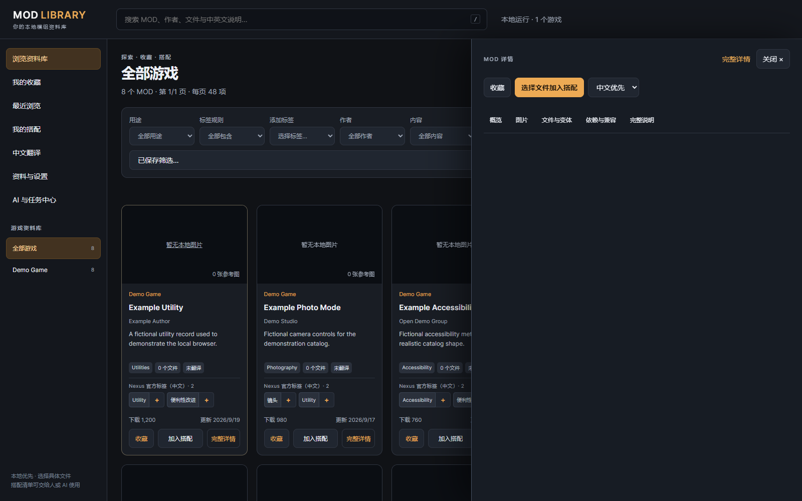
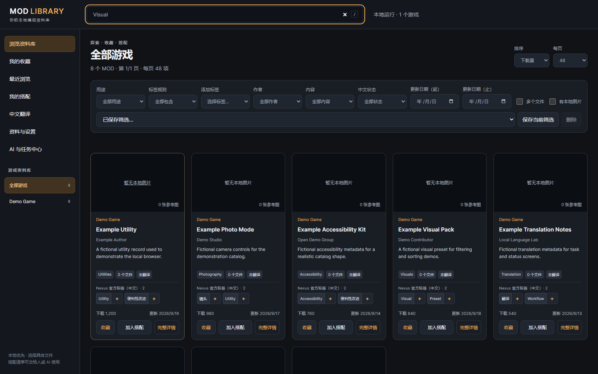
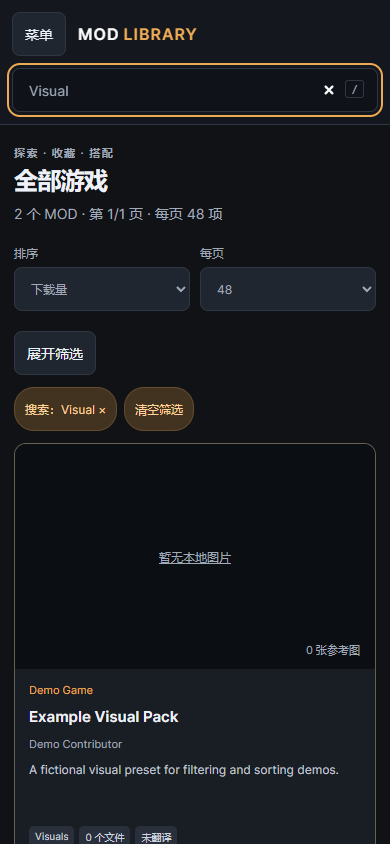
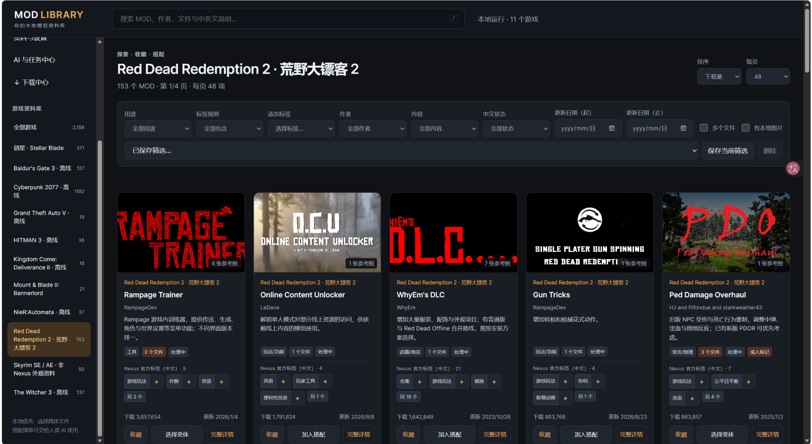
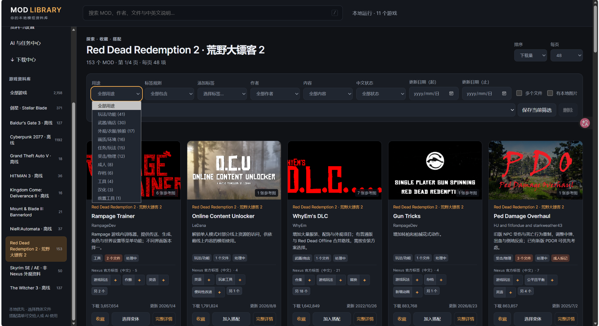
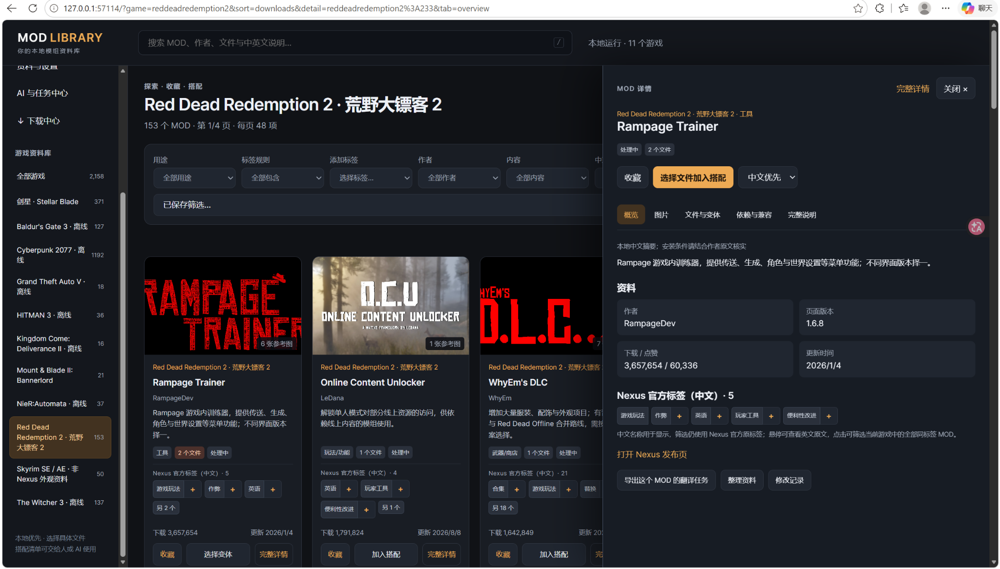
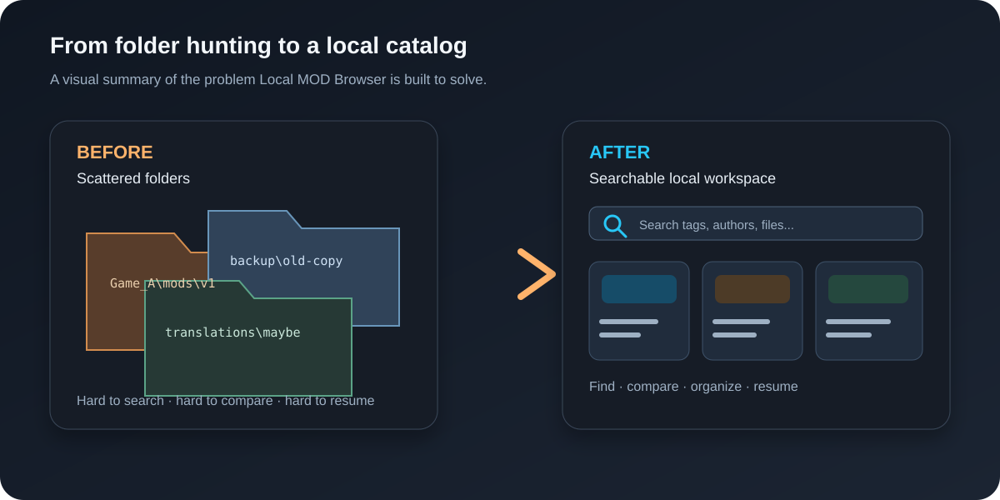

# Local MOD Browser

[简体中文](README.md) · [English](README.en.md) · [日本語](docs/i18n/README.ja.md) · [한국어](docs/i18n/README.ko.md) · [Español](docs/i18n/README.es.md) · [Français](docs/i18n/README.fr.md) · [Deutsch](docs/i18n/README.de.md) · [Português (Brasil)](docs/i18n/README.pt-BR.md) · [Русский](docs/i18n/README.ru.md) · [繁體中文](docs/i18n/README.zh-TW.md)

这些语言选项翻译的是 README，不代表应用界面或所有链接指南已经多语言化。

**版本状态（2026-10-20）：** 下一版正在独立验收，尚未发布。当前公开版本仍为 `v2.5.2`（API 契约 `2.5.0`）；下文安装步骤、功能和安全边界均针对当前公开版。开发候选及用户本地截图中的新功能，不应视为已随公开版提供。

<p align="center"></p>


[](https://github.com/son-gladyso/Local-Mod-Browser/actions/workflows/ci.yml)

> **你的 MOD 库，不该只是几个越来越大的文件夹。**
>
> 用一个本地、可搜索、可恢复、能与 AI 协作的资料工作台，把“我记得有这个 MOD”变成
> “我能在几秒内找到它、核对它、继续处理它”。
>
> **下载过一些 MOD，却忘了当初为什么下载、它们各自有什么功能？** 已有的摘要、功能说明与标签能帮你找回上下文；也可以手动把今后的使用计划写进搭配备注。浏览器不会自动推断你当初的下载动机。

[立即开始](#五分钟开始使用) · [下载 v2.5.2](https://github.com/son-gladyso/Local-Mod-Browser/releases/tag/v2.5.2) · [查看 AI 接口](#cli-与-ai-协作) · [了解安全边界](#安全边界与隐私设计) · [提交建议](https://github.com/son-gladyso/Local-Mod-Browser/issues)

## 把散落在硬盘里的 MOD，变成真正可用的个人资料库

Local MOD Browser 是一个面向 Windows 的本地 MOD 目录浏览器、资料工作台和 AI 协作平台。
它不试图替你“下载更多内容”，而是把你已经拥有、已经整理或明确授权使用的目录元数据，
转换成一个可以搜索、筛选、比较、收藏、编辑和持续维护的本地系统。

如果你曾经遇到过这些问题，它就是为你准备的：

- 下载过一些 MOD，却记不清各自的功能或当初的用途，需要借助资料库已有的摘要、功能说明与标签重新找回上下文。
- MOD 分散在多个硬盘、多个游戏和多个备份目录里，想找一个文件要翻很久。
- 同一个 MOD 有多个版本或副本，无法快速确认差异，也不敢随便覆盖原文件。
- 浏览器收藏、翻译进度、作者信息和文件清单彼此分离，重新安装后很难恢复。
- 想让 AI 帮忙整理资料，却不希望把本地路径、库存或数据库上传到第三方服务。
- 批量编辑或翻译中途停止后，不希望留下半条记录、重复提交或无法解释的状态。

它提供一个清晰的本地闭环：

```text
你的目录元数据 → 索引与搜索 → 详情 / 标签 / 文件比较 → 收藏与搭配
                                      ↓
                          资料修订 / 翻译任务 / 可恢复批处理
                                      ↓
                         网页、CLI、MCP 共用同一套本地 API
```

当前公开源码支持搭配备注，以及 `function`、`details`、`tags` 等 MOD 资料字段的修订；这不等于已有独立的“每个 MOD 的下载原因”笔记字段。找回上下文依赖已有或由你补充的信息，不会自动重建未记录的原始动机。

## 先看成品，再决定要不要安装

这些截图来自仓库内的 **8 条纯虚构 Demo 记录**，不包含真实 MOD、游戏素材或第三方站点数据。
它们展示的是公开版启动后的真实界面，而不是设计稿：









完整的可复现操作步骤见 [`docs/demo-walkthrough.md`](docs/demo-walkthrough.md)。

### 用户提供的实际使用截图

下面这组图片来自用户自己的本地资料库，展示资料较多时的浏览、筛选和详情界面。它们不是仓库附带的数据，也不是上方八条虚构记录的可复现 Demo。图片中的条目数量、游戏数量和缩略图仅反映截图当时的用户环境，不代表安装本项目后会获得这些内容。



*多游戏资料库的卡片浏览界面。*



*按用途缩小浏览范围，保留卡片与筛选条件的上下文。*



*在当前浏览页旁查看单个条目的详情。*

另三张截图：[文件与变体](docs/assets/real-use/files-and-variants.png)、[AI 与任务中心](docs/assets/real-use/ai-task-center.png)、[下载中心](docs/assets/real-use/download-center.png)。

完整的六张截图与状态说明见[实际使用图集](docs/real-use-gallery.md)。其中 AI 与任务中心、下载中心仅记录用户本地界面的可见状态；截图不证明任务或下载成功，也不证明相同功能已包含在当前公开源码或发行版中。

截图内的游戏、MOD 名称及缩略图可能涉及第三方权利，不因展示在本仓库中而适用项目代码的 MIT 许可证。图集不提供相关 MOD、游戏素材或原始资料库的下载，也不构成对第三方内容的再使用授权。

### 30 秒判断它是不是你需要的工具

| 如果你想要…… | Local MOD Browser 的答案 |
| --- | --- |
| 把多个游戏、多个硬盘的 MOD 放进同一个搜索入口 | 配置多个本地来源，统一建立可查询索引 |
| 记起下载过的 MOD 有什么用 | 回看已有摘要、功能说明与标签，并手动把计划记入搭配备注 |
| 只挑选某个 MOD 的一个准确文件 | 详情页提供文件级比较与精确选择，不默认整套加入搭配 |
| 让翻译或资料整理可以暂停后继续 | 分段任务、租约、回执、事件游标与恢复流程 |
| 让 AI 帮忙，但不上传私人库存 | 本地 HTTP / CLI / MCP，共享同一契约，默认只监听回环地址 |
| 迁移系统或升级后还能找回自己的工作 | 配对备份、恢复日志、版本历史与稳定资源身份 |

### 它适合谁？

- 有多个游戏、多个 MOD 来源或长期积累的个人玩家。
- 需要反复查找、比较、翻译、整理 MOD 资料的内容创作者和维护者。
- 想让 AI 协助做资料工作，但希望数据留在自己的电脑上的用户。
- 喜欢可复现、可检查、能恢复，而不是“点一下然后祈祷”的自动化工具的人。

### 它不是什么？

它不是 MOD 下载站、安装器、破解工具或远程托管服务。它也不会替你判断某个 MOD 是否
安全、兼容或获得授权；它负责把你已经拥有且有权使用的资料组织好，让每次修改都更可见、
更可控。



> English summary: Local MOD Browser is a privacy-first, local-only catalog and
> workflow platform for Windows. It indexes metadata supplied by the user and
> provides a browser UI, CLI and optional MCP adapter over one local API. It does
> not download, redistribute, install or execute MOD files.

## 你会得到什么

### 一个真正适合长期使用的 MOD 浏览器

- 按游戏、关键词、组合标签、翻译状态、作者、日期和文件信息快速筛选。
- 在列表、详情和历史记录之间保持稳定导航，不需要反复回到文件夹里寻找上下文。
- 查看图片、作者正文、文件清单和来源链接；比较具体文件副本，而不是只比较 MOD 名称。
- 收藏重要条目，保存可导入、可导出的搭配清单，方便重装系统或迁移目录后继续工作。
- 桌面宽屏和窄屏都可用；复杂筛选会收纳，重要结果优先呈现。

### 一套面向资料维护的工作台

- 资料修改先经过 `preview`，确认后再 `apply`，减少误改和批量操作风险。
- 翻译内容按字段和分段管理，支持批次、进度、质量检查、停止、恢复和幂等重放。
- 后台任务拥有租约、续租、交接和事件游标；换一个 AI 或重新打开页面也能接着做。
- 所有重要写入都有稳定幂等键和权威回执，网络中断后可以先查询结果，再决定是否重试。
- SQLite 使用 WAL 与 FULL 同步，配套恢复日志和成对备份，优先保护资料完整性。

### 一个可被 AI 正确使用的本地平台

- 网页、CLI 和可选 MCP 适配器共享同一套契约，不需要 AI 模拟点击网页。
- 70 项稳定操作覆盖搜索、详情、资料修订、收藏、搭配、翻译和任务管理。
- 五条确定性工作流帮助 AI 分阶段完成“查找 → 核对 → 修改 → 复读 → 汇报”。
- 本地 API 默认只监听 `127.0.0.1`；服务不调用通用模型，也不把数据自动发送到云端。
- 发生异常时客户端只收到请求 ID，本机诊断日志单独保存，避免把路径和堆栈泄露给调用方。

## 核心能力一览

| 场景 | 能力 | 适合解决的问题 |
| --- | --- | --- |
| 找资料 | 全文搜索、分页、组合标签、作者/日期/翻译状态筛选 | “我知道它大概是什么，但记不清放在哪” |
| 看细节 | 详情、图片、来源链接、文件清单、历史修订 | “这个版本到底改了什么” |
| 做选择 | 精确文件比较、收藏、搭配导入导出 | “我只想保留这一份，不想误选整套文件” |
| 改资料 | 预览—提交、版本控制、字段白名单、历史恢复 | “批量整理时也要能回滚” |
| 做翻译 | 分段任务、质量门槛、暂停/恢复、幂等回执 | “长文本中断后不要从头开始” |
| 让 AI 协作 | HTTP、CLI、MCP、租约、交接、事件游标 | “让不同助手安全接力” |
| 守住数据 | WAL/FULL、配对备份、恢复日志、生命周期锁 | “升级或崩溃后仍能恢复” |

## 安全边界与隐私设计

Local MOD Browser 的边界非常明确：

- **只索引你提供的元数据。** 仓库不附带用户的原始 MOD 库、数据库、备份或导出包。用户提供的精选界面截图单列为文档展示，不作为测试数据或内容分发。
- **不下载、不再分发、不安装、不执行 MOD。** 它是资料管理工具，不是 MOD 下载器或安装器。
- **默认只在本机监听。** 服务绑定 `127.0.0.1`，不设计为局域网或公网服务。
- **不强制绑定第三方账号。** 可选 MCP 适配器只是本地协议入口，不会自动调用远程模型。外部 AI 客户端可能把读取到的数据发送给其服务商；连接前请核对客户端设置与授权范围。
- **第三方数据由你负责授权。** 使用任何站点或服务时，请遵守其服务条款、API 政策和内容许可。

仓库还提供 [安全政策](SECURITY.md)、[贡献指南](CONTRIBUTING.md) 和
[第三方声明](THIRD_PARTY_NOTICES.md)。运行时、数据库、令牌、诊断日志和测试产物的默认路径已加入
`.gitignore`，以降低误提交风险；这不保护已跟踪文件、强制添加的文件或放在其他位置的数据。提交前仍应检查暂存区。

## 支持范围

- Windows 10/11 x64。
- 固定运行时：CPython 3.13.15 x64 与 SQLite 3.53.4。
- 首次安装需要联网下载并校验固定运行时；引导脚本由系统 Python 执行。
- 运行时来源、哈希和许可证见 [`runtime-lock.json`](runtime-lock.json)。
- Linux 和 macOS 当前不在支持范围内；核心服务依赖 Python 标准库，不需要额外后端框架。

## 五分钟开始使用

### 1. 获取代码并准备本地配置

```powershell
git clone https://github.com/son-gladyso/Local-Mod-Browser.git
cd Local-Mod-Browser
New-Item -ItemType Directory -Force data | Out-Null
Copy-Item config\sources.example.json data\sources.json
```

### 2. 安装固定运行时并启动

```powershell
python tools\bootstrap_runtime.py
.\.runtime\python.exe -X utf8 launcher.py --no-browser
```

也可以双击仓库里的 `启动MOD浏览器.cmd`。启动器会输出本机地址；打开后即可查看虚构演示
目录和空库流程。首次启动不需要准备真实 MOD 库。

如果你只想下载当前公开源码，可直接使用 [v2.5.2 Release](https://github.com/son-gladyso/Local-Mod-Browser/releases/tag/v2.5.2)
中的 `Local-Mod-Browser-2.5.2-source.zip`，旁边的 `SHA256SUMS.txt` 可用于校验文件完整性。

### 3. 接入自己的目录

编辑被 Git 忽略的 `data\sources.json`：

```json
[
  {
    "key": "mygame",
    "title": "My Game",
    "root": "D:\\Mods\\My Game",
    "outputDir": "D:\\Mods\\My Game\\catalog"
  }
]
```

每个 `outputDir` 放置一个 `catalog-data.json`。相对路径以 `sources.json` 所在目录为基准；
也可以设置 `LOCAL_MOD_BROWSER_SOURCES` 指向另一份配置。完整示例见
[`config/sources.example.json`](config/sources.example.json) 和
[`examples/demo-game/catalog-data.json`](examples/demo-game/catalog-data.json)。

### 4. 检查服务与本地 API

```powershell
.\.runtime\python.exe -X utf8 ai.py doctor
.\.runtime\python.exe -X utf8 ai.py capabilities
.\.runtime\python.exe -X utf8 ai.py games
```

打开 `/api/docs` 可以查看机器可读契约；打开 `/api/health` 可以确认运行时、数据库和服务状态。

## 第一次运行，怎样算走通了？

先用仓库自带的虚构记录，不必导入自己的资料库：启动服务 → 打开本机地址 → 搜索一个示例条目 → 打开详情 → 回到列表。这个小闭环能帮你确认浏览与查询入口，而不必先整理整个硬盘。

开始前请准备 Windows 10/11 x64、可运行引导脚本的系统 Python，以及首次下载固定运行时所需的网络。普通使用不要求接入 AI 或 MCP；开发者的测试依赖另见[贡献指南](CONTRIBUTING.md)。

**成功标准：**页面能显示虚构目录，搜索与详情可实际操作，`ai.py doctor` 的结果可供核对。仅打开页面不等于自己的来源配置、恢复流程或所有平台操作都已验收。

## 常见问题

**下载后为什么没有截图中的庞大资料库？** 那些是用户提供的实际使用截图，不随项目分发。仓库自带的是八条虚构 Demo 记录；自己的来源需要另行配置。

**它会自动扫描并理解硬盘上的所有 MOD 吗？** 不会。当前入口是来源配置与每个 `outputDir` 中的 `catalog-data.json`，不是对任意文件夹的万能识别。先用[配置样例](config/sources.example.json)核对路径与元数据。

**能替我记起当初为什么下载某个 MOD 吗？** 已有摘要、功能说明和标签能帮助你重新判断用途；你可以修订资料，并手动在搭配备注中记录计划。它不能从文件自动推断未记录的原始动机，本文也不承诺存在独立的逐 MOD 下载原因字段。

**为什么列表为空？** 先核对 `data\sources.json` 是否有效、路径以哪个配置目录解析，以及目标 `outputDir` 是否有 `catalog-data.json`。再按[用户指南](docs/user-guide.md)检查服务；不要把私人数据库直接贴进 Issue。

**必须连接 AI 才能浏览吗？** 不需要。网页和 CLI 可以直接使用。可选 MCP 是本地接口，不是自动连接云端模型的开关；你另行选择的外部客户端具有自己的数据边界。

**实拍图里的下载中心代表公开版能下载 MOD 吗？** 不能这样判断。实拍记录的是用户本地界面，其中下载列表为空、Nexus 未连接。当前公开版仍按本文的“不下载、不安装、不执行 MOD”边界介绍。

**能在其他设备或公网访问吗？** 默认只监听 `127.0.0.1`，不把它当作 LAN 或公网服务部署。Windows 以外平台当前也不在支持范围内。

### 按你要改的部分进入源码

- 浏览与交互：从 `static/` 入手，验证列表、详情、空/错误状态及窄屏行为。
- 来源与检索：从 `catalog.py` 和配置样例入手，用合成目录覆盖有效与无效输入。
- 平台操作：一起阅读 `contracts.py`、`platform_api.py` 与对应测试，保持 HTTP、CLI、MCP 一致。
- 持久化或后台任务：先读[架构说明](docs/architecture.md)，覆盖中断、重试与恢复，不以牺牲持久性换取速度。

各类改动的命令和 PR 要求见[贡献指南](CONTRIBUTING.md)；现有入门任务在[版本、路线与贡献](#版本路线与贡献)。


## CLI 与 AI 协作

CLI 是脚本和 AI 的稳定入口，不需要模拟鼠标操作：

```powershell
.\.runtime\python.exe -X utf8 ai.py tour
.\.runtime\python.exe -X utf8 ai.py capabilities
.\.runtime\python.exe -X utf8 ai.py games
.\.runtime\python.exe -X utf8 ai.py doctor
```

建议的安全工作流是：

1. 先读取能力和接口说明，确认当前版本支持的操作。
2. 先搜索和读取资源，再提交 `preview`，不要凭数组顺序猜测文件身份。
3. 检查预览返回的资源 ID、版本和差异，再使用稳定 `idempotencyKey` 提交。
4. 对后台任务等待真实终态，核对业务回读和权威回执，不把 `queued` 当作完成。
5. 中断后先查回执和事件游标，再继续、交接或重试。

详细说明：[`docs/user-guide.md`](docs/user-guide.md)、
[`docs/ai-platform-guide.md`](docs/ai-platform-guide.md)、
[`docs/architecture.md`](docs/architecture.md)。

## 验证与质量门槛

项目不是“能启动就算完成”。公开版保留了可复现的合成验收脚本：

```powershell
# Python 回归
.\.runtime\python.exe -X utf8 -m unittest discover -s tests -v

# 启动、协作与契约
.\.runtime\python.exe -X utf8 tests\startup_acceptance.py
.\.runtime\python.exe -X utf8 tests\collaboration_acceptance.py
python -m pip install jsonschema==4.26.0
python -X utf8 tests\contract_audit.py --fixture

# 前端语法
node --check static/app.js
node --check static/editor.js
node --check tests/browser.cjs
```

浏览器验收另需 `npm install` 及 Playwright 浏览器。CI 在 Windows runner 上自动执行固定运行时
安装、Python 回归、契约审计和 JavaScript 检查；详见 [贡献指南](CONTRIBUTING.md)。

## 项目结构

```text
Local-Mod-Browser/
├─ server.py                    本地 HTTP 服务与统一错误边界
├─ platform_api.py              70 项平台操作与业务规则
├─ contracts.py                 HTTP/CLI/MCP 共用契约与 Schema
├─ catalog.py                   来源配置、索引和查询投影
├─ ai.py                        面向脚本和 AI 的 CLI
├─ mcp_adapter.py               可选的本地 MCP 入口
├─ static/                      浏览器界面
├─ tests/                       回归、契约、启动、协作与性能验收
├─ tools/bootstrap_runtime.py   固定运行时安装与校验
└─ docs/                        用户、AI 平台和架构说明
```

## 版本、路线与贡献

当前公开版本为 `v2.5.2`，API 契约为 `2.5.0`。最新方向见 [`ROADMAP.md`](ROADMAP.md)；文档、可复现测试、无障碍和小范围来源配置改进都适合首次贡献。项目优先关注：

- 让本地资料整理更快、更容易复核，而不是扩大数据收集范围。
- 保持 API、CLI 和 MCP 的行为一致，并让失败可以解释、可以恢复。
- 用合成数据和可复现验收保护数据安全；不把私人库存作为公开测试样本。
- 在明确的内容授权和第三方条款范围内扩展来源适配。

欢迎提交 Issue、改进文档和 Pull Request。请先阅读 [CONTRIBUTING.md](CONTRIBUTING.md)，
不要提交个人路径、库存、数据库、截图中的令牌或任何未获授权的第三方内容。外部改动需经过审查；合并到 `main` 前须满足 CI、Code Owner 批准、讨论解决、隐私检查与针对性测试要求。

如果它解决了你的一个真实问题，欢迎点一个 Star、分享给同样被“MOD 文件夹失控”困扰的人，
或者提交一个具体的 Issue。对开源项目来说，一条清晰的使用反馈比一句“看起来不错”更有帮助。

### 从一个小改进入手

第一次参与，可以从这些已有任务选择一个：

- [首次运行 FAQ（#3）](https://github.com/son-gladyso/Local-Mod-Browser/issues/3)：补充运行时安装、来源配置和目录文件缺失的排查步骤。
- [来源配置文档与校验（#2）](https://github.com/son-gladyso/Local-Mod-Browser/issues/2)：说明字段与相对路径行为，并用合成配置覆盖错误情况。
- [空状态与错误状态的无障碍提示（#1）](https://github.com/son-gladyso/Local-Mod-Browser/issues/1)：让键盘和屏幕阅读器用户也能知道下一步做什么。

先检查任务的最新讨论与状态，再说明你准备处理的范围。小的文档修正可以直接提交 PR；较大功能、数据模型或来源适配改动，请先按贡献指南讨论。无需提供自己的 MOD 库来参与。

## 许可证

项目代码使用 [MIT License](LICENSE)。第三方运行时和可选依赖的说明见
[`THIRD_PARTY_NOTICES.md`](THIRD_PARTY_NOTICES.md)。MIT 许可不授予任何 MOD、游戏素材、
站点数据、作者正文或其他第三方内容的权利。

