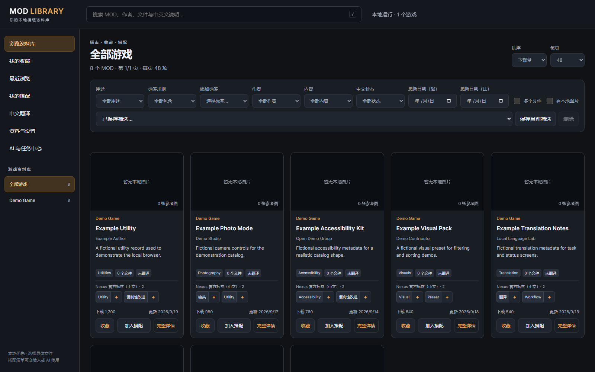
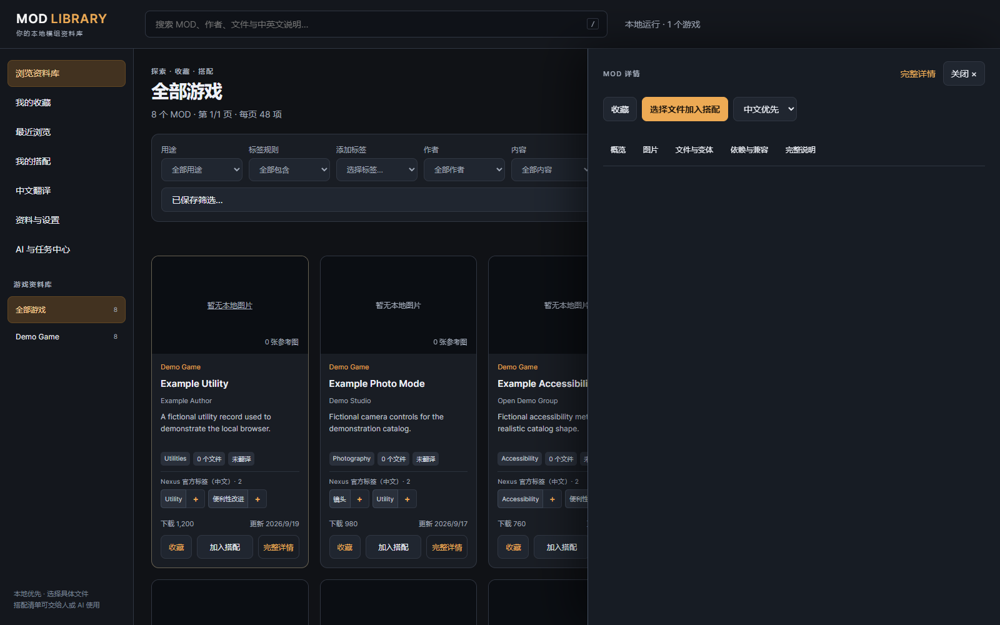
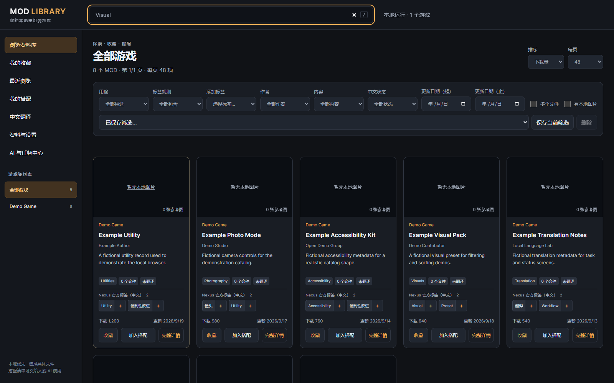
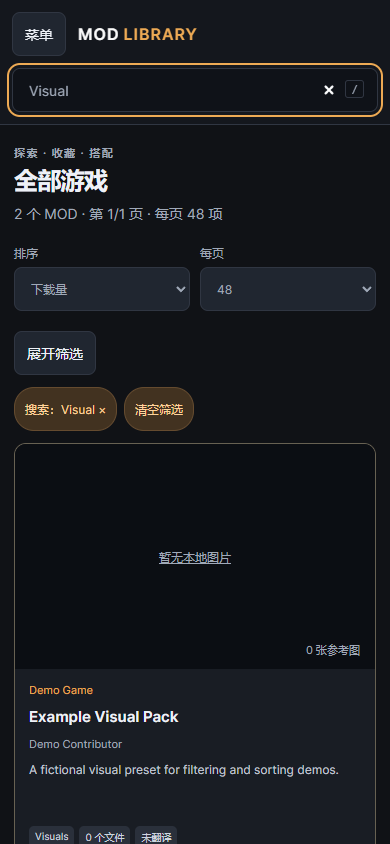
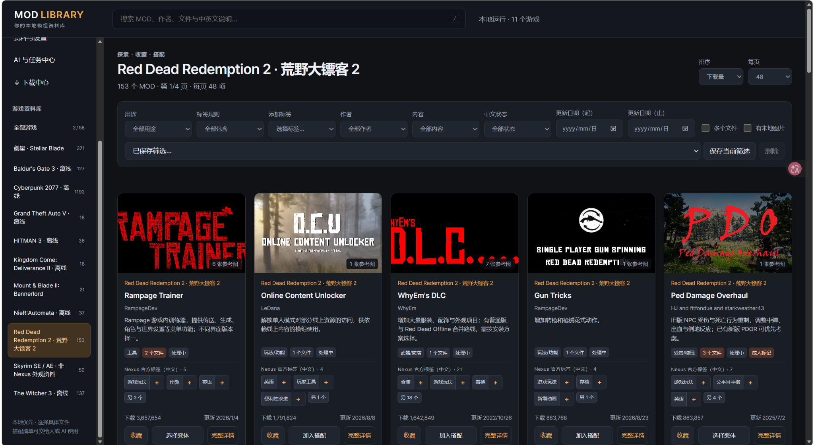
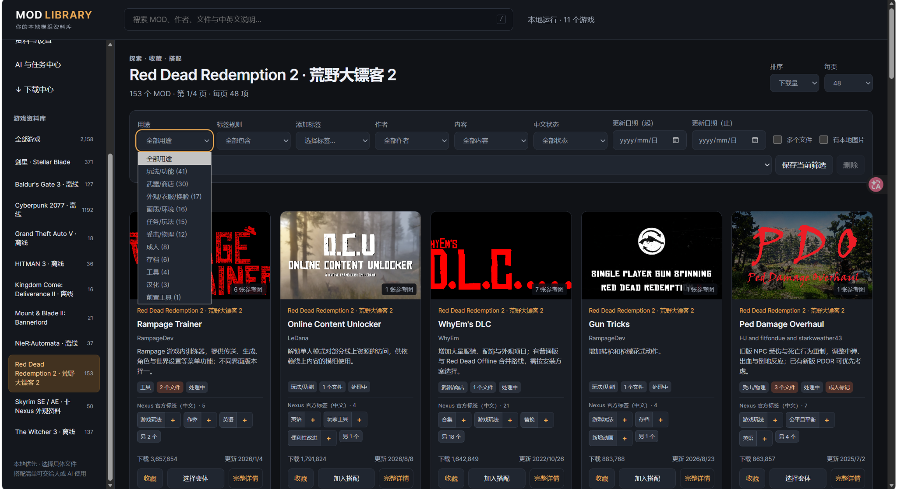
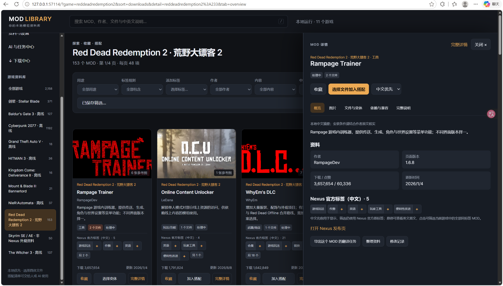
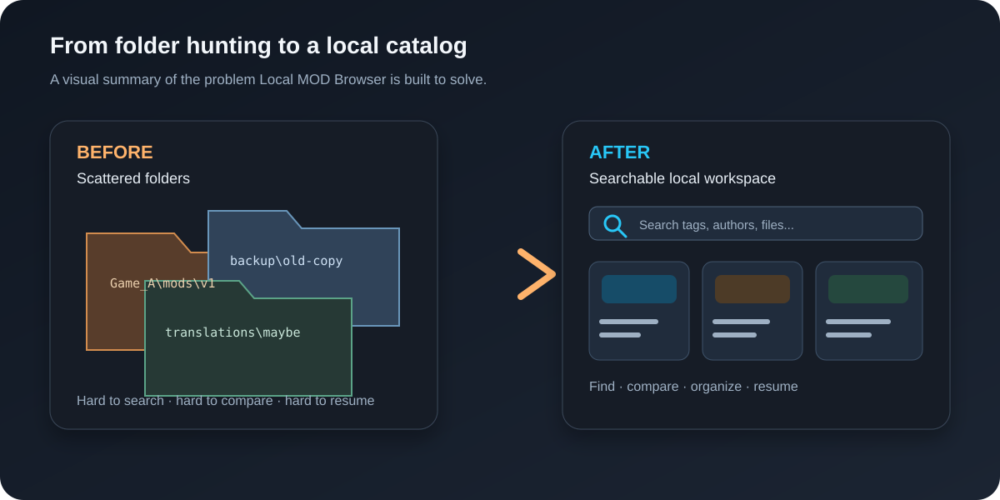

# Local MOD Browser

[简体中文](README.md) · [English](README.en.md) · [日本語](docs/i18n/README.ja.md) · [한국어](docs/i18n/README.ko.md) · [Español](docs/i18n/README.es.md) · [Français](docs/i18n/README.fr.md) · [Deutsch](docs/i18n/README.de.md) · [Português (Brasil)](docs/i18n/README.pt-BR.md) · [Русский](docs/i18n/README.ru.md) · [繁體中文](docs/i18n/README.zh-TW.md)

*语言选项翻译的是 README，不代表应用界面或所有指南已多语言化；其他语言版本可能滞后于本页。*

<p align="center"></p>


[](https://github.com/son-gladyso/Local-Mod-Browser/actions/workflows/ci.yml)

> **"我记得下过一个改天气的 MOD……是哪个游戏来着？放在 D 盘还是那块旧硬盘？下的是 1.2 还是 1.3？"**
>
> 你的 MOD 库不该只是几个越来越大的文件夹。Local MOD Browser 把它变成一个**本地、可搜索、可恢复、能和 AI 协作**的资料工作台——从"我记得有这个"到"几秒内找到、核对、继续处理"。

[五分钟开始](#五分钟开始使用) · [下载 v2.5.2](https://github.com/son-gladyso/Local-Mod-Browser/releases/tag/v2.5.2) · [给 AI 读](#-给-ai-读的部分) · [安全边界](#安全边界与隐私) · [提建议](https://github.com/son-gladyso/Local-Mod-Browser/issues)

> **版本状态（2026-10-20）：** 当前公开版为 `v2.5.2`（API 契约 `2.5.0`），下一版正在独立验收、尚未发布。本页的安装、功能和安全边界均针对公开版；开发候选和用户截图里的新功能不代表已随公开版提供。

---

## 👋 给人读的部分

### 如果你也遇到过这些

- MOD 散在好几个硬盘、好几个游戏、好几个备份目录里，找一个文件要翻半天。
- 下过的 MOD 忘了是干嘛的，也忘了当初为什么下。
- 同一个 MOD 有好几个版本或副本，不敢随便覆盖。
- 收藏、翻译进度、作者信息和文件清单各在各处，重装系统后全散了。
- 想让 AI 帮忙整理，又不想把本地路径和库存上传给第三方。
- 批量编辑或翻译做到一半停了，留下半条记录、重复提交、说不清的状态。

### 它给你的闭环

```text
你的目录元数据 → 索引与搜索 → 详情 / 标签 / 文件比较 → 收藏与搭配
                                      ↓
                          资料修订 / 翻译任务 / 可恢复批处理
                                      ↓
                         网页、CLI、MCP 共用同一套本地 API
```

| 你想要…… | 它的答案 |
| --- | --- |
| 多个游戏、多个硬盘，一个搜索入口 | 配置多个本地来源，统一建索引；按游戏、关键词、组合标签、翻译状态、作者、日期、文件信息筛选 |
| 想起某个 MOD 有什么用 | 回看已有摘要、功能说明与标签；把以后的计划手动写进搭配备注（**它不会自动推断你当初的下载动机**） |
| 只要某个 MOD 里的一个准确文件 | 文件级比较与精确选择，不默认整套加入搭配 |
| 改资料不怕手滑 | 先 `preview` 再 `apply`，字段白名单、版本历史、可回滚 |
| 长翻译中断后接着做 | 分段任务、质量门槛、暂停/恢复、幂等回执 |
| 让 AI 帮忙但数据不出门 | 本地 HTTP / CLI / MCP 共享同一契约，默认只监听 `127.0.0.1` |
| 崩溃或升级后找回工作 | SQLite WAL + FULL 同步、配对备份、恢复日志、稳定资源身份 |

### 先看成品

下面截图来自仓库自带的 **8 条纯虚构 Demo 记录**，是公开版启动后的真实界面，不是设计稿：









可复现步骤见 [`docs/demo-walkthrough.md`](docs/demo-walkthrough.md)。

#### 用户本地资料库的实际使用截图

来自用户自己的资料库，展示条目较多时的样子。**不随项目分发**，条目和缩略图只反映截图当时的用户环境。



*多游戏资料库的卡片浏览。*



*按用途缩小范围，保留卡片与筛选上下文。*



*在当前浏览页旁看单个条目的详情。*

另三张：[文件与变体](docs/assets/real-use/files-and-variants.png) · [AI 与任务中心](docs/assets/real-use/ai-task-center.png) · [下载中心](docs/assets/real-use/download-center.png)，说明见[实际使用图集](docs/real-use-gallery.md)。AI 任务中心和下载中心的截图只记录界面可见状态，**不证明任务或下载成功，也不证明这些功能已在公开版中**。截图中的游戏、MOD 名称与缩略图可能涉及第三方权利，不适用本项目的 MIT 许可。



### 它不是什么

**不是** MOD 下载站、安装器、破解工具或远程托管服务。它**不下载、不再分发、不安装、不执行** MOD，也不替你判断某个 MOD 是否安全、兼容或获得授权。它只把你已经拥有且有权使用的资料组织好。

> English summary: Local MOD Browser is a privacy-first, local-only catalog and workflow platform for Windows. It indexes metadata supplied by the user and provides a browser UI, CLI and optional MCP adapter over one local API. It does not download, redistribute, install or execute MOD files.

### 五分钟开始使用

**支持范围**：Windows 10/11 x64；固定运行时 CPython 3.13.15 x64 + SQLite 3.53.4（首次安装需联网下载并校验，来源与哈希见 [`runtime-lock.json`](runtime-lock.json)）。Linux / macOS 暂不支持。

```powershell
git clone https://github.com/son-gladyso/Local-Mod-Browser.git
cd Local-Mod-Browser
New-Item -ItemType Directory -Force data | Out-Null
Copy-Item config\sources.example.json data\sources.json
python tools\bootstrap_runtime.py
.\.runtime\python.exe -X utf8 launcher.py --no-browser
```

或者双击 `启动MOD浏览器.cmd`。打开启动器输出的本机地址，就能看到虚构 Demo 目录——**不需要先准备真实 MOD 库**。只要源码也可以下载 [v2.5.2 Release](https://github.com/son-gladyso/Local-Mod-Browser/releases/tag/v2.5.2) 的 `Local-Mod-Browser-2.5.2-source.zip`，用旁边的 `SHA256SUMS.txt` 校验。

**第一次走通**：搜索一个示例条目 → 打开详情 → 回到列表 → 跑一下 `ai.py doctor`。仅能打开页面，不等于你的来源配置或恢复流程已验收。

**接入自己的目录**：编辑被 Git 忽略的 `data\sources.json`：

```json
[
  {
    "key": "mygame",
    "title": "My Game",
    "root": "D:\\Mods\\My Game",
    "outputDir": "D:\\Mods\\My Game\\catalog"
  }
]
```

每个 `outputDir` 里放一个 `catalog-data.json`。相对路径以 `sources.json` 所在目录为基准；也可用 `LOCAL_MOD_BROWSER_SOURCES` 指向别的配置。参考 [`config/sources.example.json`](config/sources.example.json) 和 [`examples/demo-game/catalog-data.json`](examples/demo-game/catalog-data.json)。

### 常见问题

**为什么我没有截图里那么多 MOD？** 那是用户自己的库，不随项目分发；仓库只带 8 条虚构记录。
**会自动扫描理解我硬盘上所有 MOD 吗？** 不会。入口是来源配置 + 每个 `outputDir` 中的 `catalog-data.json`。
**列表为空？** 查 `data\sources.json` 是否有效、相对路径按哪个目录解析、`outputDir` 里有没有 `catalog-data.json`，再看[用户指南](docs/user-guide.md)。别把私人数据库贴进 Issue。
**必须接 AI 吗？** 不用。网页和 CLI 直接可用；MCP 是本地接口，不是连云端的开关。
**下载中心截图是说公开版能下载 MOD？** 不是。截图里下载列表为空、Nexus 未连接；公开版仍是"不下载、不安装、不执行"。
**能在局域网或公网访问吗？** 默认只监听 `127.0.0.1`，不按 LAN / 公网服务设计。

### 安全边界与隐私

- **只索引你提供的元数据。** 仓库不附带任何用户的原始 MOD 库、数据库、备份或导出。
- **默认只在本机监听**，服务绑定 `127.0.0.1`。
- **服务本身不调用通用模型。** 但你另行连接的外部 AI 客户端可能把读到的数据发给它的服务商，连接前核对其设置。
- 异常时客户端只收到请求 ID，诊断日志留在本机，不把路径和堆栈泄给调用方。
- **第三方数据的授权由你负责**，遵守相应站点条款与内容许可。
- `.gitignore` 已覆盖运行时、数据库、令牌、日志和测试产物的默认路径——但不保护强制添加或放在别处的文件，提交前看一眼暂存区。

更多：[安全政策](SECURITY.md) · [贡献指南](CONTRIBUTING.md) · [第三方声明](THIRD_PARTY_NOTICES.md)

### 参与

最新方向见 [`ROADMAP.md`](ROADMAP.md)。第一次参与可以从这些任务挑一个（先看最新讨论）：

- [首次运行 FAQ（#3）](https://github.com/son-gladyso/Local-Mod-Browser/issues/3)：运行时安装、来源配置、目录文件缺失的排查。
- [来源配置文档与校验（#2）](https://github.com/son-gladyso/Local-Mod-Browser/issues/2)：字段与相对路径行为 + 合成错误配置测试。
- [空状态与错误状态的无障碍提示（#1）](https://github.com/son-gladyso/Local-Mod-Browser/issues/1)：让键盘和读屏用户知道下一步做什么。

不需要提供你自己的 MOD 库。合并到 `main` 前须通过 CI、Code Owner 批准、讨论解决、隐私检查与针对性测试。如果它解决了你的真实问题，一个 Star 或一条具体的使用反馈都很有帮助。

### 许可证

项目代码 [MIT](LICENSE)。第三方运行时与可选依赖见 [`THIRD_PARTY_NOTICES.md`](THIRD_PARTY_NOTICES.md)。MIT 不授予任何 MOD、游戏素材、站点数据、作者正文或其他第三方内容的权利。

---

## 🤖 给 AI 读的部分

**不要模拟点击网页。** 用 CLI / HTTP / MCP——三者共享 `contracts.py` 中的同一契约（70 项稳定操作，5 条确定性工作流）。

```powershell
.\.runtime\python.exe -X utf8 ai.py tour           # 入门导览
.\.runtime\python.exe -X utf8 ai.py capabilities   # 当前版本支持的操作
.\.runtime\python.exe -X utf8 ai.py games
.\.runtime\python.exe -X utf8 ai.py doctor
```

服务运行时：`/api/docs` 是机器可读契约，`/api/health` 显示运行时、数据库、服务状态。详细：[`docs/ai-platform-guide.md`](docs/ai-platform-guide.md) · [`docs/user-guide.md`](docs/user-guide.md) · [`docs/architecture.md`](docs/architecture.md)

**标准工作流：查找 → 核对 → 修改 → 复读 → 汇报**

1. 先读 capabilities 和接口说明，确认操作存在。
2. 先搜索、读取资源，再提交 `preview`；**用资源 ID 识别文件，不要凭数组顺序猜**。
3. 核对预览返回的资源 ID、版本和差异，再用稳定的 `idempotencyKey` 提交 `apply`。
4. 后台任务等到真实终态，核对业务回读和权威回执；**`queued` 不是完成**。
5. 中断后先查回执和事件游标，再决定继续、交接或重试——不要盲目重放。

**边界：**

- 不实现或描述任何下载、安装、执行、再分发 MOD 的能力；公开版没有这些能力。
- 不把服务改为监听非回环地址；不在服务端加入对通用模型的调用。
- 不提交个人路径、库存、数据库、令牌或未授权的第三方内容；测试只用合成数据。
- 保持 HTTP / CLI / MCP 行为一致；持久化与后台任务改动要覆盖中断、重试和恢复，不以牺牲持久性换速度。
- 资料修订不存在独立的"下载原因"字段；不要虚构它。

**改哪里：**

```text
server.py                    本地 HTTP 服务与统一错误边界
platform_api.py              70 项平台操作与业务规则
contracts.py                 HTTP/CLI/MCP 共用契约与 Schema
catalog.py                   来源配置、索引、查询投影
ai.py / mcp_adapter.py       CLI / 可选本地 MCP 入口
static/                      浏览器界面（列表、详情、空/错误状态、窄屏）
tests/                       回归、契约、启动、协作、性能验收
tools/bootstrap_runtime.py   固定运行时安装与校验
```

**验证：**

```powershell
.\.runtime\python.exe -X utf8 -m unittest discover -s tests -v
.\.runtime\python.exe -X utf8 tests\startup_acceptance.py
.\.runtime\python.exe -X utf8 tests\collaboration_acceptance.py
python -m pip install jsonschema==4.26.0
python -X utf8 tests\contract_audit.py --fixture
node --check static/app.js; node --check static/editor.js; node --check tests/browser.cjs
```

浏览器验收另需 `npm install` 和 Playwright 浏览器。CI 在 Windows runner 上跑固定运行时安装、Python 回归、契约审计和 JS 检查。
