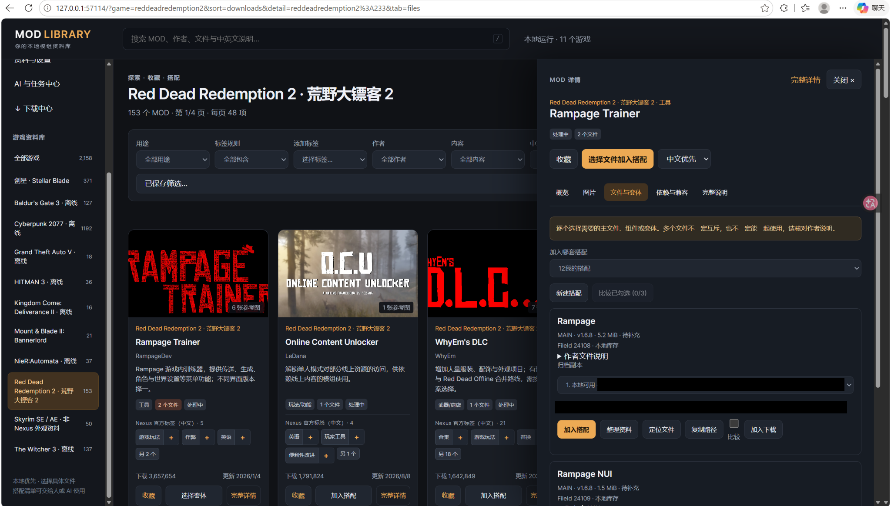
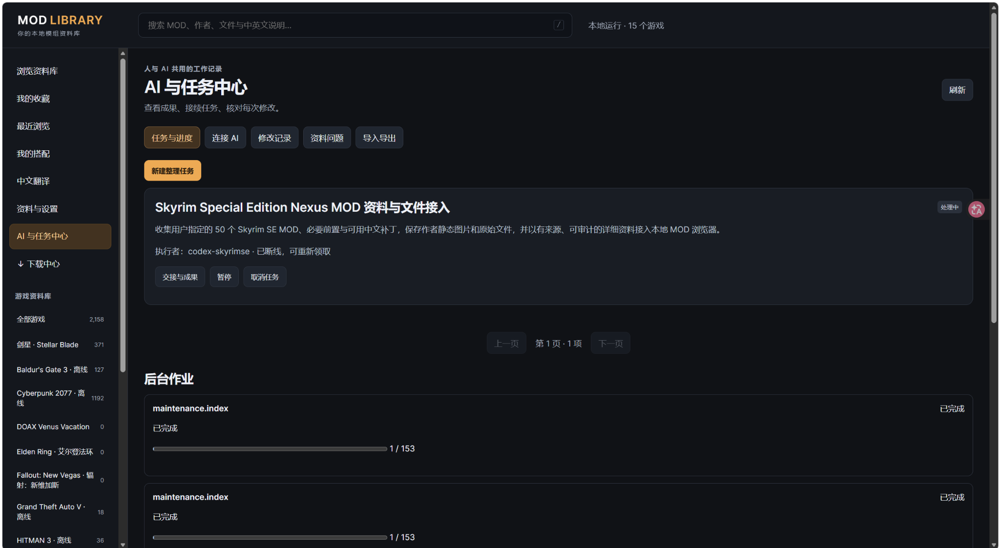
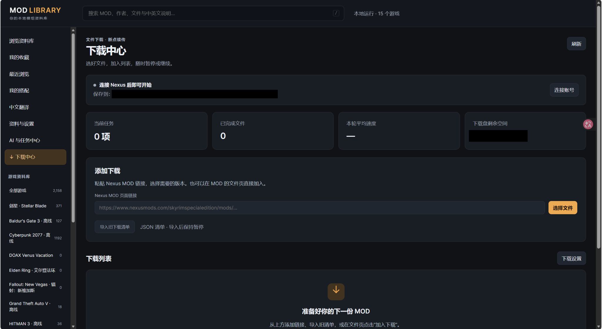

# 实际使用图集 / Actual-use gallery

## 中文

这六张截图由用户提供，来自其本地实际使用环境。图中的游戏数量、条目数量和内容随截图场景而异，不是仓库附带数据或公开发行版的容量/功能验收。可复现的纯虚构示例另见 [Demo walkthrough](demo-walkthrough.md)。

截图中的游戏、MOD 名称及缩略图可能涉及第三方权利，不受项目代码 MIT 许可证自动覆盖。这里不分发原始 MOD、游戏资源或用户资料库，也不授权他人再使用第三方内容。

### 多游戏 MOD 资料库

卡片浏览展示用户环境中的多个游戏来源。显示的数量不代表项目自带内容。

### 按用途筛选

查看筛选条件与相应卡片视图，说明用户如何缩小浏览范围。

### MOD 详情侧栏

在浏览上下文中查看单个条目的详细资料，不需要将此图片视为内容授权或兼容性验证。

### 文件与变体

条目的文件与变体视图。图片用于展示资料呈现方式，不证明文件已安装、下载或通过安全检查。

### AI 与任务中心

截图含未连接/进行中状态，不能作为任务成功或第三方 AI 已连接的证据。它展示用户本地界面；是否已包含在当前公开源码中应以该版本源码与验收记录为准。

### 下载中心

截图显示 Nexus 未连接且列表为空，不代表下载成功，也不作为当前公开项目支持下载功能的声明。公开版的功能边界以 README 与对应版本源码为准。

## English

These six screenshots were supplied by the user from their actual local environment. Game counts, item counts, and visible content vary between captures. They are not bundled data or capacity/feature acceptance evidence for the public release. The reproducible fictional sample is documented separately in the [demo walkthrough](demo-walkthrough.md).

Game and MOD names and thumbnails may involve third-party rights and are not automatically covered by the code's MIT license. This gallery does not distribute underlying MODs, game assets, or the user's source library, and grants no permission to reuse third-party content.

| Image | What it shows | Evidence boundary |
| --- | --- | --- |
| [Multi-game MOD library](assets/real-use/library-overview.png) | Card browsing across the user's game sources | Counts do not describe bundled content. |
| [Filter by purpose](assets/real-use/purpose-filters.png) | Filter controls and catalog cards | A view of the user's workflow, not a performance benchmark. |
| [MOD detail panel](assets/real-use/mod-detail-panel.png) | An entry beside the catalog | Not a content-license or compatibility verification. |
| [Files and variants](assets/real-use/files-and-variants.png) | File and variant information | Does not prove installation, download, or safety checks. |
| [AI & Task Center](assets/real-use/ai-task-center.png) | Disconnected/in-progress states in the user's local interface | Not evidence of a successful task or AI connection; public-version support must be checked against that version's source and validation. |
| [Download Center](assets/real-use/download-center.png) | Nexus disconnected and an empty list | Not a successful download or a claim that the current public project supports downloading. |

